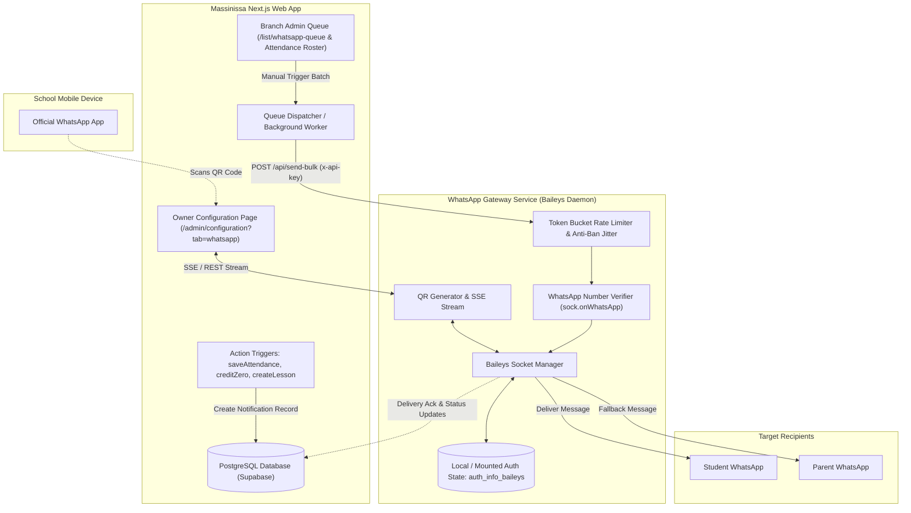
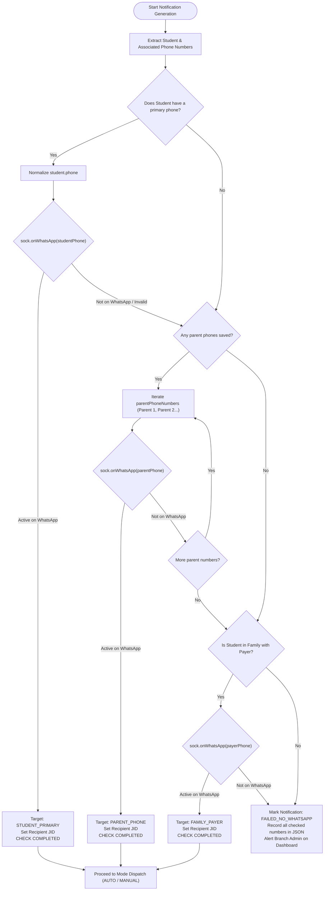
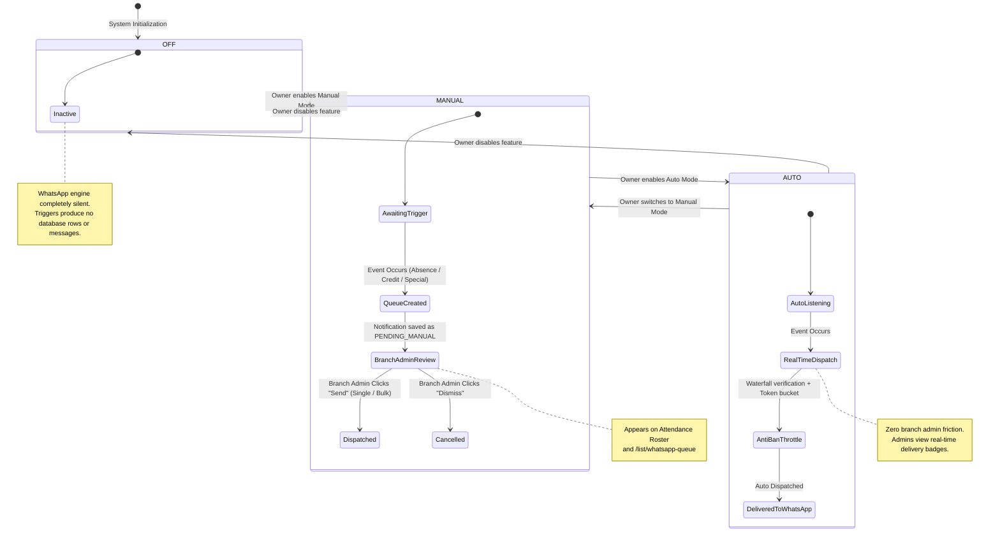
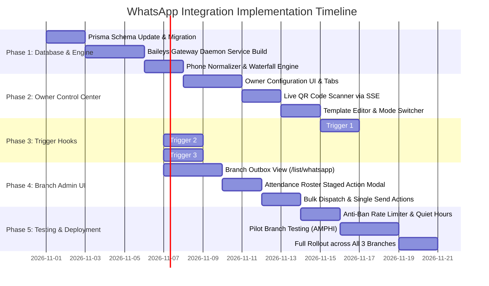

# Massinissa School Management System
## WhatsApp Integration Engine — Comprehensive Architecture & Implementation Plan

**Document Version:** 1.0.0  
**Status:** Approved for Implementation  
**Target Roles:** Owner (Device & Policy Management), Branch Admins (Operational Trigger Dispatch)  
**Applicable Branches:** ECOLE, ANNEX, AMPHI  

---

## Table of Contents
1. [Executive Summary & Core Objectives](#1-executive-summary--core-objectives)
2. [High-Level Architecture & Engine Selection](#2-high-level-architecture--engine-selection)
   - 2.1 Technology Selection: Why Baileys Multi-Device Protocol
   - 2.2 Deployment Topology (Next.js Serverless vs. Dedicated Gateway Service)
   - 2.3 End-to-End System Architecture Diagram
3. [Database Schema Enhancements (Prisma)](#3-database-schema-enhancements-prisma)
   - 3.1 New Models: `WhatsAppDeviceSession`, `WhatsAppConfig`, `WhatsAppNotification`
   - 3.2 Schema Additions & Relational Integrity
4. [Phone Verification & Fallback Waterfall Algorithm](#4-phone-verification--fallback-waterfall-algorithm)
   - 4.1 Algerian Number Normalization Engine
   - 4.2 Waterfall Resolution Flow (Student Global Number → Parents → Family Payer)
   - 4.3 WhatsApp Availability Check (`sock.onWhatsApp`) & Caching
5. [The Three Operational Modes & Role-Based Access Control](#5-the-three-operational-modes--role-based-access-control)
   - 5.1 Strict Role Governance (Owner vs. Branch Admin)
   - 5.2 Operating Mode Matrix: `OFF`, `MANUAL`, and `AUTO`
6. [Detailed Trigger Specifications & System Hooks](#6-detailed-trigger-specifications--system-hooks)
   - 6.1 Trigger 1: Student Absence Recorded
   - 6.2 Trigger 2: Lesson Credits Depleted (0 Remaining Sessions)
   - 6.3 Trigger 3: Special Lesson Scheduled (Extra, Catch-Up, Free)
7. [UI/UX Wireframes & User Experience Flows](#7-uiux-wireframes--user-experience-flows)
   - 7.1 Owner Experience: WhatsApp Control Center & Live QR Scanner
   - 7.2 Branch Admin Experience: In-Context Triggers & Branch Outbox Queue
8. [API Contracts & Internal Interface Specifications](#8-api-contracts--internal-interface-specifications)
   - 8.1 Gateway Service Internal REST & WebSocket API
   - 8.2 Next.js Server Actions & Background Dispatcher
9. [Value-Added Architectural Suggestions for Massinissa School](#9-value-added-architectural-suggestions-for-massinissa-school)
   - 9.1 Anti-Ban & Meta Compliance Engine (Rate Limiting & Jitter)
   - 9.2 Biometric K50 Scan Zero-Credit Real-Time Hook
   - 9.3 Inbound Message Webhook for Absence Justification Sync
   - 9.4 Quiet Hours & Night-Time Delay Window
   - 9.5 Cross-Branch GPS Location Pin Cards
   - 9.6 Bilingual Intelligent Template Auto-Switching (Arabic / French)
10. [Step-by-Step Phased Implementation Roadmap](#10-step-by-step-phased-implementation-roadmap)
11. [Verification & Acceptance Testing Plan](#11-verification--acceptance-testing-plan)

---

## 1. Executive Summary & Core Objectives

Massinissa School operates across three branches (ECOLE, ANNEX, AMPHI) with hundreds of active students enrolled in regular academic support classes and special formations. Communication between branch administrations and parents has traditionally relied on in-person interactions, manual phone calls, or printed vouchers. 

This implementation plan delivers a **native, device-linked WhatsApp integration** designed to narrow the school-parent communication gap. The integration connects directly to the school's official Android/iOS mobile phone through a **QR code scan**, eliminating the prohibitive per-message fees of third-party SMS gateways and Meta Cloud API while maintaining a personal school identity.

### Core Objectives:
1. **Device-Linked Multi-Device Authentication:** Connect the school's WhatsApp account seamlessly by scanning a dynamically generated QR code directly from the Owner's dashboard.
2. **Three Automated & Manual Triggers:**
   - **Absence Alert:** Triggered when a student is recorded absent during attendance taking.
   - **Zero Credit Exhaustion Alert:** Triggered when a student's remaining prepaid lesson credits reach zero.
   - **Special Lesson Announcement:** Triggered when an administrator schedules an extra, catch-up, or free lesson for groups the student is enrolled in.
3. **Smart Waterfall Contact Resolution:** Automatically verify WhatsApp availability on saved numbers, starting with the student's primary/global phone number; if unavailable, sequentially inspect parent contact numbers until an active WhatsApp account is identified.
4. **Three Operating Modes:** Support `OFF` (dormant), `MANUAL` (branch admin reviews and triggers queued messages), and `AUTO` (real-time automated dispatch).
5. **Strict Security Isolation:** Restrict device pairing, QR generation, system mode changes, and template configuration strictly to the **Owner role**, while providing branch admins with an intuitive manual outbox for day-to-day operations.

---

## 2. High-Level Architecture & Engine Selection

### 2.1 Technology Selection: Why Baileys Multi-Device Protocol

To connect an existing mobile WhatsApp number without requiring official Meta Business Cloud approval or per-conversation utility charges, web systems use WhatsApp Web protocols. We evaluate the two primary Node.js approaches:

| Dimension | `@whiskeysockets/baileys` (Recommended) | `whatsapp-web.js` (Puppeteer) | Meta Cloud API (Official BSP) |
| :--- | :--- | :--- | :--- |
| **Underlying Mechanism** | Pure WebSocket client reverse-engineering the multi-device binary protocol | Headless Chromium browser instance (Puppeteer) | Hosted HTTP Webhook API directly with Meta |
| **RAM Footprint** | **35 MB - 60 MB** | 450 MB - 800 MB per session | 0 MB (Remote API) |
| **CPU Overhead** | Minimal (light cryptographic operations) | High (Chromium page rendering & DOM events) | Zero on local server |
| **QR Code Pairing** | Direct event (`connection.update` with raw QR string) | Extracted from DOM element | N/A (Requires dedicated business number) |
| **Phone Number Check** | Native `sock.onWhatsApp(jid)` method (instant batch lookup) | Browser evaluation script | Limited verification API |
| **Stability on Linux/VPS** | Native Node.js, zero system binary dependencies | Requires `libasound2`, `libxss1`, Chromium binaries | Cloud dependent |
| **Per-Message Cost** | **0.00 DZD (Free)** | **0.00 DZD (Free)** | ~0.05 to 0.08 USD per template message |

**Conclusion:** `@whiskeysockets/baileys` is selected as the core WhatsApp engine. It is lightweight, executes directly in TypeScript/Node.js, has zero Chromium dependencies, and provides built-in methods for real-time connection state management and phone number verification.

### 2.2 Deployment Topology (Next.js Serverless vs. Dedicated Gateway Service)

The Massinissa School software is built on Next.js 16 (App Router), deployed on Vercel with PostgreSQL hosted on Supabase, and utilizes local bridge utilities (such as `zk-bridge` for ZKTeco K50 biometric devices).

> [!IMPORTANT]
> **The Serverless Constraint:**
> A persistent WhatsApp multi-device connection requires an open, uninterrupted WebSocket handshake (`wss://web.whatsapp.com/ws/chat`) to WhatsApp's servers, along with local multi-file cryptographic authentication state (`auth_info_baileys`). 
> Serverless platforms (such as Vercel Lambdas) freeze or terminate execution after HTTP request completion. A WebSocket socket **cannot** live inside a Vercel serverless function.

#### Selected Architecture: Decoupled WhatsApp Bridge Gateway
We adopt a decoupled microservice pattern that mirrors the school's existing `zk-bridge` biometric architecture:
1. **The Web Application (Next.js 16 on Vercel or Node.js):** Manages school business logic, permissions, attendance, schedules, UI dashboards, and queues notifications in PostgreSQL (`WhatsAppNotification`).
2. **The WhatsApp Gateway Service (`whatsapp-bridge`):** A lightweight Node.js daemon running either:
   - On the school's on-premise local server (alongside `zk-bridge` where internet is constant), OR
   - On a lightweight persistent Docker container / VPS (Railway, Render, DigitalOcean, or Docker Compose).
3. **Communication Channel:** Secured HTTP REST endpoints with shared secret authorization (`x-api-key: WHATSAPP_BRIDGE_SECRET`) and a Server-Sent Events (SSE) or WebSocket channel for streaming the live QR code to the Owner's browser.

### 2.3 End-to-End System Architecture Diagram



---

## 3. Database Schema Enhancements (Prisma)

To support the three modes, QR connection persistence, message queuing, delivery logs, and auditability, we introduce dedicated models in `prisma/schema.prisma`.

### 3.1 New Prisma Models

```prisma
// =================================================================
// WHATSAPP INTEGRATION MODELS
// =================================================================

enum WhatsAppMode {
  OFF
  MANUAL
  AUTO
}

enum WhatsAppTriggerType {
  ABSENCE
  CREDIT_ZERO
  SPECIAL_LESSON
}

enum WhatsAppRecipientType {
  STUDENT_PRIMARY
  PARENT_PHONE
  FAMILY_PAYER
}

enum WhatsAppNotificationStatus {
  PENDING_MANUAL    // Waiting for branch admin to click "Send"
  QUEUED            // Ready in dispatch queue (Auto or Approved Manual)
  SENDING           // In transmission pipeline
  SENT              // Dispatched to WhatsApp network
  DELIVERED         // Received by recipient's device (double tick)
  READ              // Read by recipient (blue tick)
  FAILED_NO_WHATSAPP// All checked numbers lack WhatsApp
  FAILED_ERROR      // Network or API failure
  DISMISSED         // Dismissed/cancelled by branch admin
}

model WhatsAppConfig {
  id                        String       @id @default("GLOBAL")
  mode                      WhatsAppMode @default(OFF)
  isConnected               Boolean      @default(false)
  connectedPhone            String?      // e.g., "213550123456"
  connectedName             String?      // Profile name on WhatsApp
  batteryLevel              Int?
  lastConnectedAt           DateTime?
  lastDisconnectedAt        DateTime?
  
  // Triggers Toggle
  enableAbsenceTrigger      Boolean      @default(true)
  enableCreditZeroTrigger   Boolean      @default(true)
  enableSpecialLessonTrigger Boolean     @default(true)
  
  // Message Templates (Supports placeholders: {student_name}, {class_name}, etc.)
  templateAbsenceAr         String       @db.Text
  templateAbsenceFr         String       @db.Text
  templateCreditZeroAr      String       @db.Text
  templateCreditZeroFr      String       @db.Text
  templateSpecialLessonAr   String       @db.Text
  templateSpecialLessonFr   String       @db.Text
  
  // Anti-Ban & Quiet Hours settings
  minIntervalSeconds        Int          @default(4)   // Delay between messages
  maxIntervalSeconds        Int          @default(8)   // Delay jitter
  quietHoursEnabled         Boolean      @default(true)
  quietHoursStart           String       @default("22:00") // HH:mm
  quietHoursEnd             String       @default("08:00") // HH:mm
  
  updatedAt                 DateTime     @updatedAt
}

model WhatsAppNotification {
  id              String                     @id @default(uuid())
  branchId        Int
  studentId       String
  lessonId        Int?
  classId         Int?
  triggerType     WhatsAppTriggerType
  recipientType   WhatsAppRecipientType?
  recipientPhone  String?                    // Normalized e.g., "213550123456"
  recipientName   String?
  messageContent  String                     @db.Text
  status          WhatsAppNotificationStatus @default(PENDING_MANUAL)
  
  // Error and diagnostic tracking
  attemptCount    Int                        @default(0)
  errorMessage    String?
  checkedNumbers  Json?                      // Array of [{ phone, type, hasWA: boolean }]
  
  // Audit trail
  triggeredBy     String                     // User ID or "SYSTEM_AUTO"
  approvedBy      String?                    // Branch Admin ID who authorized send
  approvedAt      DateTime?
  sentAt          DateTime?
  deliveredAt     DateTime?
  createdAt       DateTime                   @default(now())
  updatedAt       DateTime                   @updatedAt

  branch          Branch                     @relation(fields: [branchId], references: [id], onDelete: Cascade)
  student         Student                    @relation(fields: [studentId], references: [id], onDelete: Cascade)
  lesson          Lesson?                    @relation(fields: [lessonId], references: [id], onDelete: SetNull)
  class           Class?                     @relation(fields: [classId], references: [id], onDelete: SetNull)

  @@index([branchId, status])
  @@index([studentId, triggerType])
  @@index([status, createdAt])
  @@index([lessonId])
}

model WhatsAppNumberCache {
  phone           String   @id               // Normalized international format (e.g. 213550123456)
  hasWhatsApp     Boolean
  jid             String?                    // e.g. "213550123456@s.whatsapp.net"
  lastCheckedAt   DateTime @default(now())

  @@index([lastCheckedAt])
}
```

### 3.2 Relations Added to Existing Models
In `Branch`:
```prisma
whatsAppNotifications WhatsAppNotification[]
```
In `Student`:
```prisma
whatsAppNotifications WhatsAppNotification[]
```
In `Lesson`:
```prisma
whatsAppNotifications WhatsAppNotification[]
```

---

## 4. Phone Verification & Fallback Waterfall Algorithm

A critical requirement is testing WhatsApp availability across saved student records in a strict priority sequence:
1. **Primary Global Phone Number:** Stored directly on the student record (`Student.phone`).
2. **Parent Phone Numbers:** Stored in the child table `ParentPhoneNumber[]` linked to `Student.id`.
3. **Family Payer Phone (Fallback):** If the student belongs to a `Family`, inspect the payer sibling or family guardian.

### 4.1 Algerian Number Normalization Engine

In Algeria, numbers are entered in varied notations: `0550 12 34 56`, `+213 (0) 770 11 22 33`, `0661123456`, or `213550123456`. WhatsApp requires the strict international format: `213[5|6|7]XXXXXXXX@s.whatsapp.net`.

```typescript
/**
 * Normalizes Algerian mobile numbers to WhatsApp JID format
 * @param rawInput Raw input string from student or parent records
 * @returns Clean international phone string or null if invalid
 */
export function normalizeAlgerianPhone(rawInput?: string | null): string | null {
  if (!rawInput) return null;
  
  // 1. Strip all whitespace, dots, dashes, parentheses, and leading plus
  let cleaned = rawInput.replace(/[\s\.\-\(\)\+]/g, "").trim();
  
  // 2. Handle international prefix cases: "00213" -> "213"
  if (cleaned.startsWith("00213")) {
    cleaned = cleaned.substring(2);
  }
  
  // 3. Handle local Algerian zero prefix: "05", "06", "07"
  if (/^0[567]\d{8}$/.test(cleaned)) {
    cleaned = "213" + cleaned.substring(1);
  }
  
  // 4. Handle direct format: "213" + "5/6/7" + 8 digits
  if (/^213[567]\d{8}$/.test(cleaned)) {
    return cleaned;
  }
  
  // 5. Fallback check for valid international numbers (8 to 15 digits)
  if (/^\d{8,15}$/.test(cleaned)) {
    return cleaned;
  }
  
  return null;
}
```

### 4.2 Waterfall Resolution Flowchart



### 4.3 WhatsApp Verification & Caching Strategy

Querying WhatsApp for every message introduces latency and potential query limits. We implement an intelligent cache with a **14-day Time-To-Live (TTL)** in `WhatsAppNumberCache`:

```typescript
export async function resolveStudentWhatsAppRecipient(studentId: string): Promise<{
  recipientPhone: string | null;
  recipientType: "STUDENT_PRIMARY" | "PARENT_PHONE" | "FAMILY_PAYER" | null;
  recipientName: string | null;
  checkedAudit: Array<{ phone: string; type: string; hasWhatsApp: boolean }>;
}> {
  const student = await prisma.student.findUnique({
    where: { id: studentId },
    include: {
      parentPhoneNumbers: true,
      family: {
        include: {
          payerStudent: {
            include: { parentPhoneNumbers: true },
          },
        },
      },
    },
  });

  if (!student) throw new Error("Student not found");

  const checkedAudit: Array<{ phone: string; type: string; hasWhatsApp: boolean }> = [];

  // Step 1: Check Student's primary phone
  if (student.phone) {
    const norm = normalizeAlgerianPhone(student.phone);
    if (norm) {
      const hasWA = await checkWhatsAppWithCache(norm);
      checkedAudit.push({ phone: norm, type: "STUDENT_PRIMARY", hasWhatsApp: hasWA });
      if (hasWA) {
        return {
          recipientPhone: norm,
          recipientType: "STUDENT_PRIMARY",
          recipientName: student.name,
          checkedAudit,
        };
      }
    }
  }

  // Step 2: Check Parent Phone Numbers sequentially
  for (const p of student.parentPhoneNumbers) {
    const norm = normalizeAlgerianPhone(p.phone);
    if (norm) {
      const hasWA = await checkWhatsAppWithCache(norm);
      checkedAudit.push({ phone: norm, type: "PARENT_PHONE", hasWhatsApp: hasWA });
      if (hasWA) {
        return {
          recipientPhone: norm,
          recipientType: "PARENT_PHONE",
          recipientName: `ولي أمر ${student.name}`,
          checkedAudit,
        };
      }
    }
  }

  // Step 3: Check Family Payer Fallback
  if (student.family?.payerStudent && student.family.payerStudent.id !== student.id) {
    const payer = student.family.payerStudent;
    if (payer.phone) {
      const norm = normalizeAlgerianPhone(payer.phone);
      if (norm) {
        const hasWA = await checkWhatsAppWithCache(norm);
        checkedAudit.push({ phone: norm, type: "FAMILY_PAYER", hasWhatsApp: hasWA });
        if (hasWA) {
          return {
            recipientPhone: norm,
            recipientType: "FAMILY_PAYER",
            recipientName: `المسؤول العائلي (${payer.name})`,
            checkedAudit,
          };
        }
      }
    }
  }

  // Step 4: No number has WhatsApp
  return {
    recipientPhone: null,
    recipientType: null,
    recipientName: null,
    checkedAudit,
  };
}
```

---

## 5. The Three Operational Modes & Role-Based Access Control

### 5.1 Strict Role Governance (Owner vs. Branch Admin)

In alignment with Massinissa School's central permissions framework (`src/lib/permissions.ts`), device configuration and financial-level communications must maintain ironclad boundaries:

| Capability / Action | Owner Role | Branch Admin Role | Teacher Role |
| :--- | :---: | :---: | :---: |
| View WhatsApp Connection Status | ✅ Full | ❌ Hidden | ❌ Hidden |
| Generate & Scan WhatsApp QR Code | ✅ Full | ❌ Blocked | ❌ Blocked |
| Disconnect / Unlink WhatsApp Session | ✅ Full | ❌ Blocked | ❌ Blocked |
| Switch Mode (`OFF` / `MANUAL` / `AUTO`) | ✅ Full | ❌ Blocked | ❌ Blocked |
| Edit Message Templates & Triggers | ✅ Full | ❌ Blocked | ❌ Blocked |
| View Branch-Scoped Pending Trigger Queue | ✅ All Branches | ✅ Own Branch Only | ❌ Hidden |
| Click "Send WhatsApp" in Manual Mode | ✅ Allowed | ✅ Own Branch Only | ❌ Blocked |
| Edit Pending Message Draft in Manual Mode | ✅ Allowed | ✅ Own Branch Only | ❌ Blocked |
| Dismiss / Cancel Pending Notification | ✅ Allowed | ✅ Own Branch Only | ❌ Blocked |
| View Branch Delivery History & Audit Logs | ✅ All Branches | ✅ Own Branch Only | ❌ Hidden |

### 5.2 Operating Mode Matrix



1. **`OFF` Mode:** The system ignores all triggers. No queued rows are inserted, eliminating unnecessary database operations and ensuring zero external network activity.
2. **`MANUAL` Mode (Human-in-the-Loop):**
   - When an absence is recorded, credits reach zero, or a special lesson is scheduled, the system builds the message using the Owner's template, performs the contact verification waterfall, and stores the record in `WhatsAppNotification` with status `PENDING_MANUAL`.
   - **Branch Admin Visibility:** The notifications immediately populate in the branch admin's view:
     - Directly on the **Attendance Taking page** (a banner showing: *"3 students absent. Click to send WhatsApp alerts"*).
     - Directly in a dedicated **Branch WhatsApp Outbox** tab.
   - The branch admin can inspect the text, optionally append a personal remark, and click **"Send"** (or **"Send All Pending"**).
3. **`AUTO` Mode (Autonomous Dispatch):**
   - Triggers immediately transition into the `QUEUED` state.
   - The background queue worker batches messages through the rate-limiter (spacing them 4–8 seconds apart) and dispatches them directly to the student/parent without requiring human intervention.

---

## 6. Detailed Trigger Specifications & System Hooks

### 6.1 Trigger 1: Student Absence Recorded

- **System Hook Point:** `saveAttendance` and `markSingleAttendanceAction` in `src/lib/actions.ts`.
- **Condition:** When an existing attendance record changes to `"ABSENT"` or a new record is created with `status: "ABSENT"`.
- **Context Data Gathered:**
  - Student Name, Global Number (`matricule`).
  - Class Name (e.g., `4AM Math Groupe 1`).
  - Teacher Name (`Teacher.name`).
  - Lesson Start & End Time (`Lesson.startsAt`, `Lesson.endsAt`).
  - Branch Name (`Branch.name`).

#### Default Bilingual Message Template:
**Arabic:**
> السلام عليكم ورحمة الله وبركاته.  
> نعلمكم بغياب التلميذ(ة): **{student_name}** عن حصة مادة **{class_name}** (الأستاذ: **{teacher_name}**) المقررة اليوم **{date}** على الساعة **{start_time}** بمقر المؤسسة (**{branch_name}**).  
> يرجى تبرير الغياب لدى إدارة الفرع أو الرد على هذه الرسالة. شكراً لتعاونكم.  
> — *مؤسسة ماسينيسا التعليمية*

**French:**
> Bonjour,  
> Nous vous informons de l'absence de l'élève **{student_name}** au cours de **{class_name}** (Enseignant : **{teacher_name}**) prévu aujourd'hui **{date}** à **{start_time}** au siège **{branch_name}**.  
> Merci de bien vouloir contacter l'administration pour justifier cette absence.  
> — *École Massinissa*

---

### 6.2 Trigger 2: Lesson Credits Depleted (0 Remaining Sessions)

- **System Hook Point:** Evaluated post-attendance submission (`saveAttendance`), post-biometric scan resolution (`resolveBiometricScanAction`), or after subscription calculations in `computeStudentCreditAndSessions` (`src/lib/studentBilling.ts`).
- **Condition:**
  - The student is enrolled in a regular tuition group (`isFormation === false`).
  - `netSessions` recalculation reaches `<= 0`.
  - Anti-Spam Check: Ensure no credit-zero alert has already been dispatched for this student in this class within the last **7 days** (unless a new voucher was issued in between).

#### Default Bilingual Message Template:
**Arabic:**
> السلام عليكم ورحمة الله وبركاته.  
> نلفت انتباهكم الكريمة إلى أن رصيد حصص التلميذ(ة): **{student_name}** في فوج **{class_name}** قد استُنفد بالكامل (0 حصص متبقية).  
> لضمان استمرار حضور التلميذ(ة) في الحصص القادمة دون انقطاع، يُرجى التقدم لتسديد اشتراك الدورة الجديدة لدى مكتب الاستقبال بفرع **{branch_name}**.  
> — *مؤسسة ماسينيسا التعليمية*

**French:**
> Bonjour,  
> Nous vous informons que le solde de séances de l'élève **{student_name}** pour le groupe **{class_name}** est désormais épuisé (0 séance restante).  
> Afin d'assurer la continuité de ses cours sans interruption, nous vous prions de bien vouloir renouveler son abonnement auprès de l'administration du siège **{branch_name}**.  
> — *École Massinissa*

---

### 6.3 Trigger 3: Special Lesson Scheduled (Extra, Catch-Up, Free)

- **System Hook Point:** In `createLesson` action (`src/lib/actions.ts`), immediately after successful lesson creation when `isSpecialLesson` is true:
  ```typescript
  const isSpecialLesson = Boolean(isExtra || isCatchUp || isFree);
  ```
- **Target Audience:** All active enrolled students across `allAssociatedClassIds` (`[classId, ...validAdditionalClassIds]`).
- **Context Data Gathered:**
  - Lesson Type: Extra (حصة إضافية), Catch-up (حصة استدراكية), Free (حصة مجانية).
  - Date, Start Time, and End Time.
  - Classroom Name and Host Branch Name (crucial for cross-branch scheduled sessions!).
  - Teacher Name.

#### Default Bilingual Message Template:
**Arabic:**
> السلام عليكم ورحمة الله وبركاته.  
> نعلن لتلاميذ وأولياء فوج **{class_name}** عن برمجة **{lesson_type}** خاصة مع الأستاذ **{teacher_name}**:  
> 📅 **التاريخ:** {date}  
> ⏰ **التوقيت:** من {start_time} إلى {end_time}  
> 📍 **المكان:** {classroom_name} — فرع {branch_name}  
> حضور التلميذ(ة) **{student_name}** ضروري وهام. بالتوفيق والنجاح.  
> — *مؤسسة ماسينيسا التعليمية*

**French:**
> Bonjour,  
> Nous vous informons de la programmation d'une **{lesson_type}** pour le groupe **{class_name}** avec l'enseignant **{teacher_name}** :  
> 📅 **Date :** {date}  
> ⏰ **Horaire :** de {start_time} à {end_time}  
> 📍 **Lieu :** Salle {classroom_name} — Siège {branch_name}  
> La présence de l'élève **{student_name}** est vivement recommandée.  
> — *École Massinissa*

---

## 7. UI/UX Wireframes & User Experience Flows

### 7.1 Owner Experience: WhatsApp Control Center & Live QR Scanner

Located under the Owner's portal at: `/admin/configuration?tab=whatsapp` (and `/admin/whatsapp`).

#### Wireframe: Owner WhatsApp Control Center
```
+----------------------------------------------------------------------------------------------------+
|  Configuration > WhatsApp Integration                                           [Owner Exclusive]  |
+----------------------------------------------------------------------------------------------------+
|                                                                                                    |
|  [CONNECTION STATUS]                                                                               |
|  +--------------------------------------------------+  +-----------------------------------------+ |
|  |  Status: [● CONNECTED]                           |  |  Device Info:                           | |
|  |  Phone:  +213 555 12 34 56 (Massinissa Official) |  |  Engine: Baileys Multi-Device v6.x      | |
|  |  Linked: 25 Oct 2026, 09:30                      |  |  Battery: 88% (Charging)                | |
|  |                                                  |  |  Latency: 42ms                          | |
|  |  [ Disconnect WhatsApp Session ]                 |  |  [ Restart Bridge Gateway ]             | |
|  +--------------------------------------------------+  +-----------------------------------------+ |
|                                                                                                    |
|  [SYSTEM OPERATING MODE]                                                                           |
|  +---------------------------+  +---------------------------+  +---------------------------------+ |
|  |  ( ) OFF                  |  |  (*) MANUAL MODE          |  |  ( ) FULL AUTO                  | |
|  |  Triggers disabled.       |  |  Triggers queue items.    |  |  Instant background dispatch.   | |
|  |  Zero messages sent.      |  |  Branch admins click send.|  |  Autonomous parent alerts.      | |
|  +---------------------------+  +---------------------------+  +---------------------------------+ |
|                                                                                                    |
|  [AUTOMATED TRIGGERS TOGGLE]                                                                       |
|  [✓] Absence Alerts (Trigger 1)                                                                    |
|  [✓] Zero Credit Alerts (Trigger 2)                                                                |
|  [✓] Special Lesson Announcements (Trigger 3)                                                      |
|                                                                                                    |
|  [MESSAGE TEMPLATES & VARIABLES]                                                                   |
|  Select Trigger: [ Absence Alert                    v ]   Language: [ Arabic (العربية) v ]         |
|  +-----------------------------------------------------------------------------------------------+ |
|  | السلام عليكم ورحمة الله وبركاته، نعلمكم بغياب التلميذ(ة): {student_name} عن حصة مادة...      | |
|  +-----------------------------------------------------------------------------------------------+ |
|  Dynamic Tags: [{student_name}] [{class_name}] [{teacher_name}] [{date}] [{start_time}] [{branch}] |
|                                                                                                    |
|  [ Save Configuration Changes ]                                                                    |
+----------------------------------------------------------------------------------------------------+
```

#### Wireframe: Live QR Code Modal (When Disconnected)
```
+-------------------------------------------------------------+
|  Link School Mobile Device to Massinissa System             |
+-------------------------------------------------------------+
|                                                             |
|           +-------------------------------+                 |
|           |       ■■■■■■■   ■   ■■■■■■■   |                 |
|           |       ■     ■  ■■■  ■     ■   |                 |
|           |       ■■■■■■■   ■   ■■■■■■■   |                 |
|           |        ■■■  ■■■■■■■■■  ■■■    |                 |
|           |       ■■■■■■■   ■   ■■■■■■■   |                 |
|           |       ■     ■  ■■■  ■     ■   |                 |
|           |       ■■■■■■■       ■■■■■■■   |                 |
|           +-------------------------------+                 |
|             Refreshing in 18s [ Refresh Now ]               |
|                                                             |
|  Instructions:                                              |
|  1. Open WhatsApp on the school's phone                     |
|  2. Go to Settings > Linked Devices > Link a Device         |
|  3. Point your camera at this screen to scan the QR code    |
|                                                             |
|  Status: Waiting for QR scan from school phone...           |
|                                                             |
|                                                [ Cancel ]   |
+-------------------------------------------------------------+
```

---

### 7.2 Branch Admin Experience: In-Context Triggers & Branch Outbox Queue

In **MANUAL** mode, the system provides branch administrators with immediate, intuitive controls integrated right into their existing workflows.

#### Placement 1: Directly on Attendance Roster (`AttendanceRoster.tsx`)
When a branch admin or teacher finishes taking attendance and records one or more students as **ABSENT**:
```
+----------------------------------------------------------------------------------------------------+
|  [!] 4 Absences Recorded in this Lesson!                                                            |
|  WhatsApp notifications have been staged in your branch outbox queue.                               |
|                                                                                                    |
|  Students:                                                                                         |
|  • Amine Benali (0555-12-34-56 - Student)               [ Review & Send ] [ Dismiss ]               |
|  • Sarah Kaci (0661-98-76-54 - Parent: Ahmed Kaci)     [ Review & Send ] [ Dismiss ]               |
|  • Youcef Brahimi (0770-44-33-22 - Student)            [ Review & Send ] [ Dismiss ]               |
|  • Meriem Touati (No WhatsApp on saved numbers)         [ Flag Contact ]                           |
|                                                                                                    |
|  [ Send All 3 WhatsApp Alerts Now ]                          [ Review in Outbox ]                  |
+----------------------------------------------------------------------------------------------------+
```

#### Placement 2: Dedicated Branch Communications Outbox (`/list/whatsapp-queue`)
A centralized management view scoped strictly to the logged-in branch admin's branch (`session.branchIds`):
```
+----------------------------------------------------------------------------------------------------+
|  Branch Communications > WhatsApp Outbox [Siège: AMPHI]                             Filter: [All v] |
+----------------------------------------------------------------------------------------------------+
|  [Search student...]   [Filter by Trigger: All v]   [Status: Pending v]   [ Refresh Queue ]        |
|                                                                                                    |
|  [ Bulk Action: Send All Selected (6) ]   [ Dismiss Selected ]                                     |
|                                                                                                    |
|  [✓]  STUDENT       TRIGGER       RECIPIENT & TYPE    MESSAGE PREVIEW        STATUS     ACTIONS    |
|  +-----------------------------------------------------------------------------------------------+ |
|  [✓]  Amine Benali  Absence       0555-12-34-56       "نعلمكم بغياب التلميذ  PENDING    [Send WA]  |
|       Mat: 1042                   (Student Global)     أمين عن حصة الرياضيات"           [Edit] [X] |
|                                                                                                    |
|  [✓]  Lina Hadj     0 Credits     0661-88-99-00       "نلفت انتباهكم أن      PENDING    [Send WA]  |
|       Mat: 1109     (Exhausted)   (Parent: Father)     رصيد حصص لينا انتهى"            [Edit] [X] |
|                                                                                                    |
|  [✓]  Groupe 3AM-1  Special Lesson 0770-12-88-44      "برمجة حصة استدراكية   PENDING    [Send WA]  |
|       Karim Sahli   (Catch-Up)    (Parent: Mother)     يوم السبت 14:00..."              [Edit] [X] |
|                                                                                                    |
|  [ ]  Yacine Ouali  Absence       No WhatsApp Found   "Tried 055011... and   NO_WA      [Update    |
|       Mat: 1088                   (2 numbers checked)  066122... No WA"                 Number]    |
|                                                                                                    |
|  Page 1 of 3 (18 Pending Items)                                                                    |
+----------------------------------------------------------------------------------------------------+
```

---

## 8. API Contracts & Internal Interface Specifications

### 8.1 Gateway Service Internal REST & WebSocket API

The dedicated Node.js WhatsApp daemon (`whatsapp-bridge`) runs on a protected port (e.g., `http://localhost:5001` or private internal network URL `https://wa.massinissa.school`):

#### 1. `GET /api/session/status`
- **Headers:** `x-api-key: [SECRET]`
- **Response:**
  ```json
  {
    "success": true,
    "isConnected": true,
    "phone": "213555123456",
    "name": "Massinissa School Office",
    "battery": 88
  }
  ```

#### 2. `GET /api/session/qr-stream` (Server-Sent Events)
- **Headers:** `x-api-key: [SECRET]`
- **Streams live QR code updates:**
  ```
  event: qr
  data: {"qr": "data:image/png;base64,iVBORw0KGgoAAAANSUhEUgAA...", "expiresIn": 20}
  
  event: connected
  data: {"phone": "213555123456", "name": "Massinissa School"}
  ```

#### 3. `POST /api/check-numbers`
- **Headers:** `x-api-key: [SECRET]`
- **Body:** `{ "phones": ["213550112233", "213661445566"] }`
- **Response:**
  ```json
  {
    "results": [
      { "phone": "213550112233", "exists": true, "jid": "213550112233@s.whatsapp.net" },
      { "phone": "213661445566", "exists": false, "jid": null }
    ]
  }
  ```

#### 4. `POST /api/send-message`
- **Headers:** `x-api-key: [SECRET]`
- **Body:**
  ```json
  {
    "to": "213550112233@s.whatsapp.net",
    "text": "السلام عليكم، نعلمكم بغياب التلميذ...",
    "notificationId": "uuid-v4-notification-id"
  }
  ```
- **Response:**
  ```json
  {
    "success": true,
    "messageId": "WA_MSG_ID_ABC123",
    "status": "SENT",
    "sentAt": "2026-10-25T10:45:00.000Z"
  }
  ```

### 8.2 Next.js Server Actions & Background Dispatcher

Implemented in `src/lib/whatsappActions.ts`:

```typescript
"use server";

import prisma from "@/lib/prisma";
import { getAuthSession } from "@/lib/auth";
import { revalidatePath } from "next/cache";

/**
 * Dispatches a single staged notification (Manual Mode or Auto Retry)
 */
export async function sendWhatsAppNotificationAction(notificationId: string) {
  const session = await getAuthSession();
  
  const notification = await prisma.whatsappNotification.findUnique({
    where: { id: notificationId },
    include: { branch: true },
  });

  if (!notification) {
    return { success: false, message: "Notification introuvable" };
  }

  // Branch Scope Check
  if (!session.isOwner && !session.branchIds.includes(notification.branchId)) {
    return { success: false, message: "Accès non autorisé pour ce siège" };
  }

  if (!notification.recipientPhone) {
    return { success: false, message: "Aucun numéro WhatsApp valide associé" };
  }

  // Dispatch to WhatsApp Bridge Gateway
  const res = await fetch(`${process.env.WHATSAPP_BRIDGE_URL}/api/send-message`, {
    method: "POST",
    headers: {
      "Content-Type": "application/json",
      "x-api-key": process.env.WHATSAPP_BRIDGE_SECRET || "",
    },
    body: JSON.stringify({
      to: `${notification.recipientPhone}@s.whatsapp.net`,
      text: notification.messageContent,
      notificationId: notification.id,
    }),
  });

  const data = await res.json();
  if (data.success) {
    await prisma.whatsappNotification.update({
      where: { id: notificationId },
      data: {
        status: "SENT",
        sentAt: new Date(),
        approvedBy: session.userId || "ADMIN",
        approvedAt: new Date(),
      },
    });

    revalidatePath("/list/whatsapp-queue");
    return { success: true, message: "Message WhatsApp envoyé avec succès" };
  } else {
    await prisma.whatsappNotification.update({
      where: { id: notificationId },
      data: {
        status: "FAILED_ERROR",
        errorMessage: data.error || "Erreur de transmission",
        attemptCount: { increment: 1 },
      },
    });

    return { success: false, message: data.error || "Échec de l'envoi" };
  }
}
```

---

## 9. Value-Added Architectural Suggestions for Massinissa School

To ensure this WhatsApp integration is robust, durable, and beneficial to the daily administration of Massinissa School, the following 6 production-grade enhancements are integrated into the design:

### 9.1 Anti-Ban & Meta Compliance Engine (Rate Limiting & Jitter)
> [!WARNING]
> **Anti-Ban Protection:**
> When scheduling a special lesson for 80 students across 3 merged groups, firing 80 WhatsApp messages in a single second will immediately flag the school's number for spam heuristics on WhatsApp's network, resulting in a temporary or permanent account ban.

**Built-In Protection:**
1. **Token-Bucket Queue with Jitter:** Messages are dispatched with randomized intervals between **4 to 8 seconds** (`minIntervalSeconds: 4`, `maxIntervalSeconds: 8`).
2. **Dynamic Greeting Jitter:** Prepend dynamic variations to the opening greeting (e.g. alternating between *"السلام عليكم ورحمة الله"* and *"تحية طيبة وبعد"* / *"Bonjour"* and *"Chers parents"*) to prevent hash-identical bulk content flags.
3. **Daily Quota Throttling:** Enforce a maximum cap of 450 automated messages per day per SIM.

### 9.2 Biometric K50 Scan Zero-Credit Real-Time Hook
The school has already deployed ZKTeco K50 biometric devices connected via `zk-bridge`. 
When a student scans their fingerprint at the door:
- The system runs `processBiometricScan` in `src/lib/biometricActions.ts`.
- If the student has **0 remaining credits**, the scan log is tagged `status: "NO_CREDITS"`.
- **Integrated Hook:** Rather than waiting for the lesson attendance roster to be saved hours later, the system can instantly stage a "Zero-Credit Arrival" alert to the parent's WhatsApp:
  > *"نحيطكم علماً بأن التلميذ(ة) {student_name} قد سجل حضوره الآن عبر جهاز البصمة، ونذكركم بأن رصيده قد انتهى (0 حصص). يرجى التكرم بتجديد الاشتراك اليوم."*

### 9.3 Inbound Message Webhook for Absence Justification Sync
When parents receive an absence notification, their immediate reflex is to reply directly on WhatsApp (e.g. *"Il est malade aujourd'hui"* or *"هو مريض وسيعود غداً"*).
- The Baileys Gateway listens to `messages.upsert` events for incoming replies.
- The reply is matched to the most recent `WhatsAppNotification` sent to that number within the last 24 hours.
- The parent's reply is automatically recorded into `Attendance.justification` with the badge `[Via WhatsApp]` and updates the attendance status from `ABSENT` to `JUSTIFIED_ABSENCE` or alerts the branch admin for one-click approval.

### 9.4 Quiet Hours & Night-Time Delay Window
Administrators often enter schedules or complete class paperwork late in the evening (e.g., 22:30). Sending automated pings to parents late at night causes friction and annoyance.
- System defines configurable **Quiet Hours** (default: `22:00` to `08:00`).
- If a trigger is generated during quiet hours, it is saved with `scheduledFor: Next Morning at 08:15`.
- At 08:15, the dispatcher automatically resumes processing.

### 9.5 Cross-Branch GPS Location Pin Cards
Under Massinissa School's multi-branch model, when a teacher holds a special catch-up session at a different branch (e.g., an ECOLE class hosted in an AMPHI classroom due to room availability), parents and students frequently get confused about the physical venue.
- For Trigger 3 (Special Lessons), if the classroom branch differs from the student's registered branch, the system automatically appends a **Google Maps Location Link** for the destination building:
  > 📍 *مقر الحصة: قاعة 3، فرع أمفي (شارع الشهداء): https://maps.google.com/?q=...*

### 9.6 Bilingual Intelligent Template Auto-Switching
Some parents prefer Arabic (the default in Algerian schools), while others communicate in French.
- Allow setting a `preferredLocale` ("ar" | "fr") in the `Student` or `Parent` profile.
- The trigger automatically selects `templateAbsenceAr` or `templateAbsenceFr` according to the family's preferred language.

---

## 10. Step-by-Step Phased Implementation Roadmap



### Detailed Phase Breakdown:

#### Phase 1: Database Models & Gateway Infrastructure (Days 1–5)
1. Add `WhatsAppConfig`, `WhatsAppNotification`, and `WhatsAppNumberCache` to `prisma/schema.prisma`.
2. Run Prisma migration: `npx prisma db push` or `prisma migrate dev --name add_whatsapp_models`.
3. Create `whatsapp-bridge` daemon project directory with `@whiskeysockets/baileys`, `pino`, and `express`.
4. Implement persistent socket authentication (`useMultiFileAuthState`) and QR code event broadcaster.
5. Implement the Algerian phone normalization utility and `checkWhatsAppWithCache` function.

#### Phase 2: Owner Control Center & QR Scanner (Days 6–10)
1. Add the new "WhatsApp" tab to `/admin/configuration/page.tsx` and `ConfigurationClient.tsx`.
2. Build `WhatsAppControlSection.tsx` containing status badges, device info cards, and the 3-mode radio group (`OFF`, `MANUAL`, `AUTO`).
3. Build the interactive live QR code modal with auto-refresh and SSE connection stream.
4. Implement the template editor with live phone preview and dynamic chip insertions.

#### Phase 3: Trigger System Hooks (Days 11–15)
1. **Absence Hook:** In `src/lib/actions.ts` (`saveAttendance` and `markSingleAttendanceAction`), intercept `status === "ABSENT"` to generate notifications.
2. **Zero-Credit Hook:** In `src/lib/studentBilling.ts` and post-attendance resolution, evaluate `netSessions <= 0` with 7-day cooldown prevention.
3. **Special Lesson Hook:** In `createLesson`, trigger audience notification generation when `isExtra || isCatchUp || isFree`.

#### Phase 4: Branch Admin Experience & Manual Outbox (Days 16–20)
1. Build the dedicated Branch Outbox at `/list/whatsapp-queue/page.tsx` with filtering, search, and bulk selection.
2. Enhance `AttendanceRoster.tsx` to display an inline staged notification alert banner upon saving absences.
3. Implement Server Actions for `sendWhatsAppNotificationAction`, `sendAllPendingBranchAction`, and `dismissNotificationAction`.

#### Phase 5: Anti-Ban Protection, Pilot Testing & Rollout (Days 21–25)
1. Configure token-bucket rate limiter with 4–8 second delays and quiet-hours hold.
2. Conduct a pilot test at the AMPHI branch with a test group.
3. Verify receipt on student phone, parent phone fallback, and unverified number error handling.
4. Deploy to production across all 3 branches.

---

## 11. Verification & Acceptance Testing Plan

| # | Test Scenario | Expected Outcome | Verification Steps |
| :- | :--- | :--- | :--- |
| **T1** | **Owner QR Code Scan** | QR renders in browser; school phone scans QR; connection status flips to 🟢 `Connected (+213...)`. | Open `/admin/configuration?tab=whatsapp` as Owner, open WhatsApp Linked Devices, scan QR. |
| **T2** | **Strict Owner Role Wall** | Branch Admin navigating to `/admin/configuration?tab=whatsapp` is blocked with unauthorized badge. | Log in as Branch Admin; attempt direct navigation. |
| **T3** | **Mode = OFF Test** | Absences marked, 0 credits hit, or lessons scheduled produce 0 database queue items. | Set mode to `OFF`, mark 3 absences in attendance roster; verify `WhatsAppNotification` table has no new records. |
| **T4** | **Waterfall Check: Student Phone Has WA** | System detects student's primary phone has WhatsApp; sets recipient to `STUDENT_PRIMARY` and stops checking parents. | Mark absence for student whose `phone` is on WhatsApp; verify `recipientPhone` matches student phone. |
| **T5** | **Waterfall Check: Fallback to Parent** | Student phone has no WhatsApp; system checks `ParentPhoneNumber` and sends to Parent. | Set student phone to a landline/fake number; set parent phone to valid WhatsApp; mark absence; verify parent receives ping. |
| **T6** | **Waterfall Check: No Number Has WA** | Notification status transitions to `FAILED_NO_WHATSAPP`; flagged in branch queue. | Remove all WhatsApp numbers; verify warning banner appears on attendance view. |
| **T7** | **Manual Mode Branch Outbox** | Absences generate `PENDING_MANUAL` records; Branch Admin sees queue, clicks "Send", message delivers. | Set mode to `MANUAL`; take attendance; click "Send All" from outbox; verify single double-ticks on phones. |
| **T8** | **Auto Mode Instant Dispatch** | Save attendance; within 10 seconds, parent receives message automatically with zero admin clicks. | Set mode to `AUTO`; mark absence; verify message arrives autonomously. |
| **T9** | **Special Lesson Multi-Group Blast** | Scheduling extra lesson for 2 merged classes queues alerts for all enrolled students with rate-limiting. | Schedule extra lesson with 2 groups; inspect queue; verify 4-8 second interval between sends. |
| **T10** | **Quiet Hours Hold** | Notification triggered at 23:30 is held with `scheduledFor: 08:15` next morning. | Trigger absence during quiet hours; verify status stays held until 08:15. |

---

*Document Author: Antigravity AI Architecture Team*  
*Target Environment: Massinissa School Management System (Next.js 16 App Router, Prisma, PostgreSQL, Baileys v6)*
