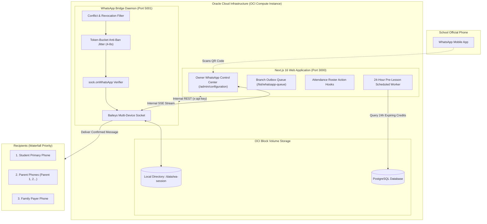
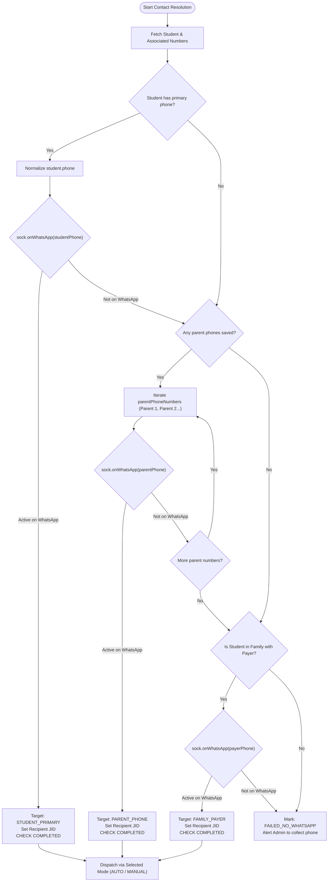
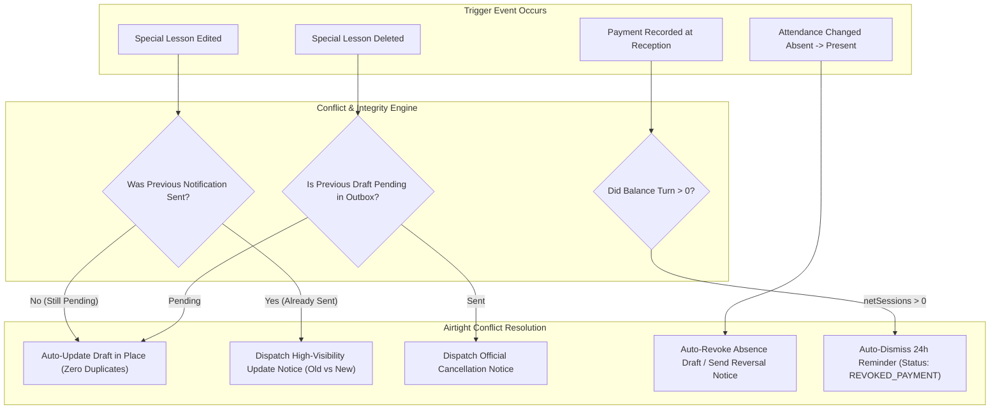

# Massinissa School Management System
## WhatsApp Integration Engine — Comprehensive Architecture & Conflict-Proof Implementation Plan

**Document Version:** 2.0.0  
**Status:** Approved for Implementation (Updated with Oracle Cloud Architecture & Conflict Protections)  
**Target Roles:** Owner (Device & Policy Management), Branch Admins (Operational Trigger Dispatch)  
**Applicable Branches:** ECOLE, ANNEX, AMPHI  
**Target Infrastructure:** Oracle Cloud Infrastructure (OCI Compute / Docker Stack)  

---

## Table of Contents
1. [Executive Summary & Core Objectives](#1-executive-summary--core-objectives)
2. [Infrastructure Architecture: Oracle Cloud Infrastructure (OCI)](#2-infrastructure-architecture-oracle-cloud-infrastructure-oci)
   - 2.1 Oracle Cloud Dedicated Stack vs. Serverless
   - 2.2 Baileys Multi-Device Protocol & Persistent Session Storage
   - 2.3 End-to-End System Architecture on OCI
3. [Database Schema Enhancements (Prisma)](#3-database-schema-enhancements-prisma)
   - 3.1 Updated Models: `WhatsAppConfig`, `WhatsAppNotification`, `WhatsAppNumberCache`, `LessonRevision`
   - 3.2 Idempotency, Versioning & Audit Integrity
4. [Phone Verification & Fallback Waterfall Algorithm](#4-phone-verification--fallback-waterfall-algorithm)
   - 4.1 Algerian Number Normalization Engine
   - 4.2 Waterfall Resolution Flow (Student Global Number → Parents → Family Payer)
   - 4.3 WhatsApp Availability Check (`sock.onWhatsApp`) & Caching
5. [The Three Operational Modes & Role-Based Access Control](#5-the-three-operational-modes--role-based-access-control)
   - 5.1 Strict Role Governance (Owner vs. Branch Admin)
   - 5.2 Operating Mode Matrix: `OFF`, `MANUAL`, and `AUTO`
6. [Detailed Trigger Specifications & System Hooks](#6-detailed-trigger-specifications--system-hooks)
   - 6.1 Trigger 1: Student Absence Recorded
   - 6.2 Trigger 2: Lesson Credits Depleted (0 Remaining) & **24-Hour Pre-Lesson -1 Balance Warning**
   - 6.3 Trigger 3: Special Lesson Scheduled & **Rescheduling / Update Confirmation**
7. [Comprehensive Conflict Prevention & Misleading Information Protections](#7-comprehensive-conflict-prevention--misleading-information-protections)
   - 7.1 Conflict 1: Special Lesson Edited / Rescheduled after Initial Announcement
   - 7.2 Conflict 2: Special Lesson Cancelled / Deleted after Announcement
   - 7.3 Conflict 3: Attendance Mistake (Marked Absent, then Corrected to Present / Late Arrival)
   - 7.4 Conflict 4: Payment Settled at Desk while Reminder is Pending in Outbox
   - 7.5 Conflict 5: Multiple Lessons on the Same Day / Back-to-Back Sessions
   - 7.6 Conflict 6: Sibling / Family Disambiguation on Shared Parent Phones
   - 7.7 Conflict 7: Group Transfers & Dropped Enrollments
   - 7.8 Conflict 8: Anti-Spam Cooldown & Message Idempotency Locks
8. [UI/UX Wireframes & User Experience Flows](#8-uiux-wireframes--user-experience-flows)
   - 8.1 Owner Control Center & Live QR Scanner
   - 8.2 Branch Admin Experience: Attendance Roster In-Context Bar & Branch Outbox
9. [API Contracts & Internal Interface Specifications](#9-api-contracts--internal-interface-specifications)
   - 9.1 OCI Internal REST & WebSocket Bridge API
   - 9.2 Next.js Server Actions & 24-Hour Pre-Lesson Background Worker
10. [Value-Added Architectural Suggestions for Massinissa School](#10-value-added-architectural-suggestions-for-massinissa-school)
    - 10.1 Anti-Ban Compliance Engine (Token-Bucket Jitter)
    - 10.2 Biometric K50 Scan Zero-Credit Real-Time Hook
    - 10.3 Inbound Message Webhook for Absence Justification Sync
    - 10.4 Quiet Hours & Night-Time Delay Window
    - 10.5 Cross-Branch GPS Location Pin Cards
    - 10.6 Bilingual Auto-Switching (Arabic / French)
11. [Step-by-Step Phased Implementation Roadmap](#11-step-by-step-phased-implementation-roadmap)
12. [Verification & Acceptance Testing Plan](#12-verification--acceptance-testing-plan)

---

## 1. Executive Summary & Core Objectives

Massinissa School operates across three branches (ECOLE, ANNEX, AMPHI) with hundreds of active students enrolled in regular academic support classes and special formations. Communication between branch administrations and parents has traditionally relied on in-person interactions, manual phone calls, or printed vouchers. 

This updated specification incorporates the school's **migration to Oracle Cloud Infrastructure (OCI)** (eliminating serverless limitations) and implements **airtight conflict protections** against misleading notifications—such as rescheduled special lessons, attendance reversals, payment race conditions, and pre-lesson -1 balance warnings.

### Core Objectives:
1. **Device-Linked Multi-Device Authentication:** Connect the school's WhatsApp account seamlessly by scanning a dynamically generated QR code directly from the Owner's dashboard.
2. **Three Core Triggers (Enhanced):**
   - **Absence Alert:** Triggered when a student is recorded absent during attendance taking, with automatic reversal notices if corrected to present.
   - **Zero Credit Exhaustion & 24-Hour Pre-Lesson Warning:** Triggered when credits hit 0, and dispatched **exactly 24 hours before the student's next scheduled lesson** to warn that attending without payment will result in a **negative balance (-1 balance)**.
   - **Special Lesson Announcement & Update Confirmation:** Triggered upon lesson creation, and **re-triggered upon any schedule update** with an explicit confirmation message ensuring parents follow the revised schedule.
3. **Smart Waterfall Contact Resolution:** Automatically verify WhatsApp availability on saved numbers, starting with the student's primary/global phone number; if unavailable, sequentially inspect parent contact numbers until an active WhatsApp account is identified.
4. **Three Operating Modes:** Support `OFF` (dormant), `MANUAL` (branch admin reviews and triggers queued messages), and `AUTO` (real-time automated dispatch).
5. **Conflict-Proof Design:** Zero false alarms, real-time balance re-verification before sending, and full revision tracking for modified sessions.

---

## 2. Infrastructure Architecture: Oracle Cloud Infrastructure (OCI)

### 2.1 Oracle Cloud Dedicated Stack vs. Serverless

The application is hosted on **Oracle Cloud Infrastructure (OCI)** (e.g., Oracle Linux Compute Instance running Node.js / Docker Compose). This architectural environment provides significant advantages over serverless hosting:

| Dimension | Serverless (e.g. Vercel) | Dedicated OCI Stack (Current Architecture) |
| :--- | :--- | :--- |
| **Process Lifespan** | Ephemeral (spin-down after HTTP response) | **Continuous long-lived Node.js process / Docker daemon** |
| **WebSocket Connection** | Disconnects on lambda termination | **Permanent, unbroken WebSocket to WhatsApp Multi-Device** |
| **Session Authentication State** | Lost without remote redis/S3 synchronization | **Native persistent OCI Block Volume (`auth_info_baileys`)** |
| **Cron / Background Scheduling** | Requires third-party cloud schedulers | **Native Node.js cron worker (`node-cron`) running 24/7 on VM** |
| **Network Latency** | Webhook network hops across regions | **Zero-latency internal socket (`localhost:5001`)** |
| **Operational Cost** | High tier-based invocations | **Fixed, low-cost OCI compute (Always Free / standard shape)** |

### 2.2 Baileys Multi-Device Protocol & Persistent Session Storage

`@whiskeysockets/baileys` runs natively inside the OCI VM as a dedicated system service (`systemd`) or companion container in `docker-compose.yml`.
- **Session Persistence:** Credentials generated during the initial QR code scan are stored in `/opt/massinissa/data/wa-session` (mounted as a Docker volume).
- **Auto-Recovery:** If the OCI VM or Docker container restarts, Baileys automatically restores the active WhatsApp session from disk within 3 seconds **without requiring a new QR scan**.
- **Low Footprint:** Consumes only ~40MB of RAM, leaving full system resources available for Next.js and PostgreSQL.

### 2.3 End-to-End System Architecture on OCI



---

## 3. Database Schema Enhancements (Prisma)

### 3.1 New Prisma Models

```prisma
// =================================================================
// WHATSAPP INTEGRATION & CONFLICT PROTECTION MODELS
// =================================================================

enum WhatsAppMode {
  OFF
  MANUAL
  AUTO
}

enum WhatsAppTriggerType {
  ABSENCE
  ABSENCE_CORRECTION          // Reversal notice when marked present after absent
  CREDIT_ZERO_INSTANT         // Triggered immediately when credit hits 0
  CREDIT_ZERO_PRE_LESSON_24H  // Triggered 24 hours before next lesson (-1 debt warning)
  SPECIAL_LESSON_NEW          // Initial announcement
  SPECIAL_LESSON_UPDATE       // Schedule/room modified confirmation notice
  SPECIAL_LESSON_CANCELLED    // Cancellation notice
}

enum WhatsAppRecipientType {
  STUDENT_PRIMARY
  PARENT_PHONE
  FAMILY_PAYER
}

enum WhatsAppNotificationStatus {
  PENDING_MANUAL    // Waiting for branch admin to click "Send"
  QUEUED            // Ready in dispatch queue (Auto or Approved Manual)
  SENDING           // In transmission pipeline
  SENT              // Dispatched to WhatsApp network
  DELIVERED         // Received by recipient's device (double tick)
  READ              // Read by recipient (blue tick)
  REVOKED_PAYMENT   // Auto-dismissed because student paid at desk before send
  REVOKED_CORRECTED // Auto-dismissed because attendance was corrected to present
  SUPERSEDED        // Draft replaced by an updated revision
  FAILED_NO_WHATSAPP// All checked numbers lack WhatsApp
  FAILED_ERROR      // Network or API failure
  DISMISSED         // Manually dismissed by branch admin
}

model WhatsAppConfig {
  id                        String       @id @default("GLOBAL")
  mode                      WhatsAppMode @default(OFF)
  isConnected               Boolean      @default(false)
  connectedPhone            String?      // e.g., "213550123456"
  connectedName             String?      // Profile name on WhatsApp
  batteryLevel              Int?
  lastConnectedAt           DateTime?
  lastDisconnectedAt        DateTime?
  
  // Triggers Toggle
  enableAbsenceTrigger      Boolean      @default(true)
  enableCreditZeroTrigger   Boolean      @default(true)
  enablePreLesson24hTrigger Boolean      @default(true)
  enableSpecialLessonTrigger Boolean     @default(true)
  
  // Message Templates (Supports placeholders: {student_name}, {class_name}, etc.)
  templateAbsenceAr         String       @db.Text
  templateAbsenceFr         String       @db.Text
  templateAbsenceCorrectedAr String      @db.Text
  templateCreditZeroAr      String       @db.Text
  templateCreditZeroFr      String       @db.Text
  templatePreLesson24hAr    String       @db.Text
  templatePreLesson24hFr    String       @db.Text
  templateSpecialLessonNewAr String      @db.Text
  templateSpecialLessonUpdAr String      @db.Text // Confirmed update template
  templateSpecialLessonCanAr String      @db.Text // Cancellation template
  
  // Anti-Ban & Quiet Hours settings
  minIntervalSeconds        Int          @default(4)   // Delay between messages
  maxIntervalSeconds        Int          @default(8)   // Delay jitter
  quietHoursEnabled         Boolean      @default(true)
  quietHoursStart           String       @default("22:00") // HH:mm
  quietHoursEnd             String       @default("08:00") // HH:mm
  
  updatedAt                 DateTime     @updatedAt
}

model WhatsAppNotification {
  id              String                     @id @default(uuid())
  branchId        Int
  studentId       String
  lessonId        Int?
  classId         Int?
  revisionNumber  Int                        @default(1) // Tracks update iterations
  triggerType     WhatsAppTriggerType
  recipientType   WhatsAppRecipientType?
  recipientPhone  String?                    // Normalized e.g., "213550123456"
  recipientName   String?
  messageContent  String                     @db.Text
  status          WhatsAppNotificationStatus @default(PENDING_MANUAL)
  
  // Context metadata for conflict resolution (stored as JSON)
  // e.g., { oldStartsAt, newStartsAt, oldRoom, newRoom, remainingCredits }
  contextData     Json?                      
  
  // Error and diagnostic tracking
  attemptCount    Int                        @default(0)
  errorMessage    String?
  checkedNumbers  Json?                      // Array of [{ phone, type, hasWA: boolean }]
  
  // Audit trail
  triggeredBy     String                     // User ID or "SYSTEM_AUTO" | "CRON_WORKER_24H"
  approvedBy      String?                    // Branch Admin ID who authorized send
  approvedAt      DateTime?
  sentAt          DateTime?
  deliveredAt     DateTime?
  createdAt       DateTime                   @default(now())
  updatedAt       DateTime                   @updatedAt

  branch          Branch                     @relation(fields: [branchId], references: [id], onDelete: Cascade)
  student         Student                    @relation(fields: [studentId], references: [id], onDelete: Cascade)
  lesson          Lesson?                    @relation(fields: [lessonId], references: [id], onDelete: SetNull)
  class           Class?                     @relation(fields: [classId], references: [id], onDelete: SetNull)

  @@index([branchId, status])
  @@index([studentId, triggerType])
  @@index([status, createdAt])
  @@index([lessonId, revisionNumber])
}

model WhatsAppNumberCache {
  phone           String   @id               // Normalized international format (e.g. 213550123456)
  hasWhatsApp     Boolean
  jid             String?                    // e.g. "213550123456@s.whatsapp.net"
  lastCheckedAt   DateTime @default(now())

  @@index([lastCheckedAt])
}
```

---

## 4. Phone Verification & Fallback Waterfall Algorithm

### 4.1 Algerian Number Normalization Engine

```typescript
export function normalizeAlgerianPhone(rawInput?: string | null): string | null {
  if (!rawInput) return null;
  let cleaned = rawInput.replace(/[\s\.\-\(\)\+]/g, "").trim();
  if (cleaned.startsWith("00213")) cleaned = cleaned.substring(2);
  if (/^0[567]\d{8}$/.test(cleaned)) cleaned = "213" + cleaned.substring(1);
  if (/^213[567]\d{8}$/.test(cleaned)) return cleaned;
  if (/^\d{8,15}$/.test(cleaned)) return cleaned;
  return null;
}
```

### 4.2 Waterfall Resolution Flowchart



---

## 5. The Three Operational Modes & Role-Based Access Control

### 5.1 Strict Role Governance (Owner vs. Branch Admin)

| Capability / Action | Owner Role | Branch Admin Role | Teacher Role |
| :--- | :---: | :---: | :---: |
| View WhatsApp Device Connection Status | ✅ Full | ❌ Hidden | ❌ Hidden |
| Generate & Scan WhatsApp QR Code | ✅ Full | ❌ Blocked | ❌ Blocked |
| Disconnect / Unlink WhatsApp Session | ✅ Full | ❌ Blocked | ❌ Blocked |
| Switch Mode (`OFF` / `MANUAL` / `AUTO`) | ✅ Full | ❌ Blocked | ❌ Blocked |
| Configure Message Templates & Triggers | ✅ Full | ❌ Blocked | ❌ Blocked |
| View Branch-Scoped Pending Trigger Queue | ✅ All Branches | ✅ Own Branch Only | ❌ Hidden |
| Click "Send WhatsApp" in Manual Mode | ✅ Allowed | ✅ Own Branch Only | ❌ Blocked |
| Edit Pending Message Draft in Manual Mode | ✅ Allowed | ✅ Own Branch Only | ❌ Blocked |
| Dismiss / Cancel Pending Notification | ✅ Allowed | ✅ Own Branch Only | ❌ Blocked |

### 5.2 Operating Mode Matrix

- **`OFF` Mode:** The system ignores all triggers. No queued rows are inserted, zero messages are transmitted.
- **`MANUAL` Mode (Human-in-the-Loop):**
  - Triggers format the message and save it in `WhatsAppNotification` as `PENDING_MANUAL`.
  - Appears on the **Attendance Taking Roster** and the **Branch Outbox Queue** (`/list/whatsapp-queue`).
  - Branch admins review the pre-formatted text, optionally edit, and click **"Send"** (or **"Send All Pending"**).
- **`AUTO` Mode (Autonomous Dispatch):**
  - Triggers immediately transition into the `QUEUED` state.
  - The background queue worker batches messages through the rate-limiter (spacing them 4–8 seconds apart) and dispatches them directly without human intervention.

---

## 6. Detailed Trigger Specifications & System Hooks

### 6.1 Trigger 1: Student Absence Recorded
- **Hook Point:** `saveAttendance` and `markSingleAttendanceAction` in [`src/lib/actions.ts`](file:///c:/Users/wassi/OneDrive/Bureau/massinissa-school-software/src/lib/actions.ts).
- **Condition:** An attendance record is created or updated with `status: "ABSENT"`.
- **Payload:** Student Name, Matricule, Class Name, Teacher Name, Date, Time Slot, Branch Name.

---

### 6.2 Trigger 2: Lesson Credits Depleted (0 Remaining) & 24-Hour Pre-Lesson -1 Balance Warning

This trigger handles the full credit exhaustion lifecycle to ensure parents understand why tuition must be paid:

#### Part A: Instant Zero-Credit Alert (Post-Attendance / Scan)
- **Condition:** Evaluated immediately after an attendance session or biometric scan consumes the student's last prepaid credit, leaving `netSessions === 0`.
- **Message:** Informs parents that all prepaid sessions have been consumed and encourages renewal at the branch desk.

#### Part B: The 24-Hour Pre-Lesson Warning (-1 Balance Alert)
- **Schedule:** Run by an automated background worker (`node-cron` on OCI) every hour.
- **Evaluation Window:** Scans for scheduled lessons starting between **23 and 25 hours from now** (`startsAt >= now + 23h AND startsAt <= now + 25h`).
- **Target Condition:**
  - Student is enrolled (`Enrollment.status === "ACTIVE"`).
  - Student is in a paying category (`payerStatus === "NORMAL"`).
  - Calculated `netSessions <= 0`.
- **The Core Conflict Warning:** The message explicitly emphasizes that if the student attends tomorrow's lesson without bringing payment, **their account balance will drop into the negative (-1 balance / رصيد سالب)** and they may face suspension.

#### Default 24-Hour Warning Message Template:
**Arabic:**
> ⚠️ **تنبيه هام بشأن حصة الغد وتجديد الاشتراك**  
> السلام عليكم ورحمة الله وبركاته.  
> نود تذكيركم بأن التلميذ(ة): **{student_name}** (فوج: **{class_name}**) لديه(ا) حصة مبرمجة يوم غد **{date}** على الساعة **{start_time}** بمقر **{branch_name}**.  
> نلفت انتباهكم الكريمة إلى أن **رصيد الحصص المتبقية حالياً هو: (0 حصص)**.  
> 🔴 **ملاحظة هامة:** في حال حضور التلميذ(ة) لحصة الغد دون تسوية الاشتراك، سيصبح الرصيد سالباً **(-1 حصة في ذمة الولي)**.  
> لتفادي أي إحراج للتلميذ أو تعليق لحضوره، يُرجى تزويده بمبلغ الاشتراك لتسديده لدى مكتب الاستقبال قبل الدخول إلى القاعة. شكراً لتفهمكم وحرصكم الدائم.  
> — *إدارة مؤسسة ماسينيسا التعليمية*

---

### 6.3 Trigger 3: Special Lesson Scheduled & Rescheduling Update Confirmation

- **Hook Point:** `createLesson` and `updateLesson` in [`src/lib/actions.ts`](file:///c:/Users/wassi/OneDrive/Bureau/massinissa-school-software/src/lib/actions.ts).
- **Target Audience:** All active enrolled students across `allAssociatedClassIds` (handles merged classes via [`LessonGroup`](file:///c:/Users/wassi/OneDrive/Bureau/massinissa-school-software/prisma/schema.prisma#L177-L187)).

#### Sub-Scenario A: Initial Special Lesson Creation (`SPECIAL_LESSON_NEW`)
- Dispatches the standard special lesson announcement (Date, Start/End time, Classroom, Branch, Teacher).

#### Sub-Scenario B: Rescheduled / Updated Special Lesson (`SPECIAL_LESSON_UPDATE`)
- If an admin edits a special lesson after notifications were already sent:
- System increments `revisionNumber` (e.g., Revision 2).
- Dispatches a high-priority confirmation message explicitly contrasting the old schedule with the new confirmed schedule.

#### Default Confirmation Message Template:
**Arabic:**
> ⚠️ **تنبيه هام ومؤكد: تعديل موعد الحصة الإضافية**  
> السلام عليكم ورحمة الله وبركاته.  
> ننهي إلى علم تلاميذ وأولياء فوج: **{class_name}** (الأستاذ: **{teacher_name}**) أنه **قد تم رسمياً تعديل موعد الحصة المعلن عنها سابقاً**.  
> ❌ **الموعد السابق الملغى:** {old_date} على الساعة {old_start_time}  
> 🟢 **الموعد الجديد والمؤكد رسمياً:** **{new_date}** من الساعة **{new_start_time}** إلى **{new_end_time}**  
> 📍 **المكان المؤكد:** قاعة **{classroom_name}** — فرع **{branch_name}**  
> نرجو منكم اعتماد هذا الموعد المؤكد حصراً وإلغاء أي موعد سابق. نعتذر عن هذا التغيير الطارئ ونتمنى لأبنائنا دوام التوفيق.  
> — *إدارة مؤسسة ماسينيسا التعليمية*

---

## 7. Comprehensive Conflict Prevention & Misleading Information Protections

To guarantee that parents never receive false alarms, conflicting schedules, or duplicate payment requests, the system implements 8 specialized conflict engines:



### 7.1 Conflict 1: Special Lesson Edited / Rescheduled after Initial Announcement
- **The Risk:** Parents receive two different times and show up at the wrong time or call the school confused.
- **Protection Logic:**
  1. Detect changes in `startsAt`, `endsAt`, `classroomId`, or `branchId` in `updateLesson`.
  2. If the previous notification for this `lessonId` is still `PENDING_MANUAL`:
     - **Update the draft in-place** with new dates and revision counter. No extra messages generated.
  3. If previous notifications were already `SENT`:
     - Create a new batch with `triggerType = "SPECIAL_LESSON_UPDATE"` and `revisionNumber = 2`.
     - Message template strictly lists: `[Old Cancelled Schedule]` vs `[New Confirmed Schedule]` with alert banners.

### 7.2 Conflict 2: Special Lesson Cancelled / Deleted after Announcement
- **The Risk:** Students arrive at a closed school or empty classroom.
- **Protection Logic:**
  1. Intercept `deleteLesson` in [`src/lib/actions.ts`](file:///c:/Users/wassi/OneDrive/Bureau/massinissa-school-software/src/lib/actions.ts).
  2. Purge any `PENDING_MANUAL` records immediately.
  3. If notifications were already `SENT`, stage or dispatch an urgent **Cancellation Notice** (`SPECIAL_LESSON_CANCELLED`) instructing students not to travel to the school.

### 7.3 Conflict 3: Attendance Mistake (Marked Absent, then Corrected to Present / Late Arrival)
- **The Risk:** Student arrives 10 minutes late. Teacher marked absent at 14:00, then corrects to present at 14:15. Parent receives an alarming message that their child skipped school.
- **Protection Logic:**
  1. In `AUTO` mode: A **10-minute dispatch delay buffer** holds absence alerts, allowing late arrivals to be recorded without dispatching false alarms.
  2. If status is updated from `ABSENT` to `PRESENT`:
     - If the notification is `PENDING_MANUAL` or held in buffer: **Delete it immediately** (`REVOKED_CORRECTED`).
     - If already `SENT`: Automatically stage/send a reassuring **Attendance Correction Notice**:
       - ✅ *"نحيطكم علماً بأن التلميذ(ة) [X] قد التحق بحصته (حاضر) وتم تصحيح حالة الحضور في النظام. نعتذر عن الإشعار السابق الناتج عن تسجيل أولي."*

### 7.4 Conflict 4: Payment Settled at Desk while Reminder is Pending in Outbox
- **The Risk:** 24h cron creates a payment reminder for a student with 0 credits. Parent arrives at 16:00 and pays. The branch admin clicks "Send All" at 17:00, sending an insulting payment demand to a parent who just paid.
- **Protection Logic:**
  - **Just-In-Time (JIT) Verification:** At the exact millisecond before any credit reminder is dispatched to WhatsApp (both in AUTO and MANUAL modes), the dispatcher executes a live balance check via `computeStudentCreditAndSessions`.
  - If `netSessions > 0`: The notification is instantly marked `REVOKED_PAYMENT` and dropped. The parent receives nothing.

### 7.5 Conflict 5: Multiple Lessons on the Same Day / Back-to-Back Sessions
- **The Risk:** Student is absent from Math at 13:00 and Physics at 15:00. Parent gets two alerts and thinks it's a software glitch.
- **Protection Logic:**
  - Every notification payload includes distinct markers:
    - Subject Name (`Class.name`)
    - Teacher Name (`Teacher.name`)
    - Time Slot (`13:00 - 15:00`)
    - Branch Building (`AMPHI - Salle 2`)
  - Unique composite index `@@unique([studentId, lessonId, triggerType, revisionNumber])` prevents any duplicate generation for the same session.

### 7.6 Conflict 6: Sibling / Family Disambiguation on Shared Parent Phones
- **The Risk:** Two brothers share the father's phone number. An alert says "Your child is absent" without specifying which child.
- **Protection Logic:**
  - Every message strictly begins with the student's full name and school matricule in bold:
    - 👤 **التلميذ(ة):** أمين بن علي (رقم القيد: 1042)
    - 📚 **الفوج:** 4AM رياضيات

### 7.7 Conflict 7: Group Transfers & Dropped Enrollments
- **The Risk:** Student moved from Group 1 to Group 2. Group 1 schedules a special lesson.
- **Protection Logic:**
  - Audience queries strictly filter by `Enrollment.status === "ACTIVE" AND Enrollment.classId === targetClassId`. Dropped or transferred students are automatically excluded.

### 7.8 Conflict 8: Anti-Spam Cooldown & Message Idempotency Locks
- **The Risk:** Rapid double-clicking by branch admins sending the same notification twice.
- **Protection Logic:**
  - Distributed database locking: When a branch admin clicks "Send", status flips from `PENDING_MANUAL` to `SENDING` in an atomic transaction. Any secondary click is rejected with: *"Notification already in transmission"*.

---

## 8. UI/UX Wireframes & User Experience Flows

### 8.1 Owner Control Center & Live QR Scanner
Located at `/admin/configuration?tab=whatsapp`. Strictly Owner-Only.

```
+----------------------------------------------------------------------------------------------------+
|  Configuration > WhatsApp Integration [Oracle Cloud Deployment]                 [Owner Exclusive]  |
+----------------------------------------------------------------------------------------------------+
|                                                                                                    |
|  [CONNECTION STATUS]                                                                               |
|  +--------------------------------------------------+  +-----------------------------------------+ |
|  |  Status: [● CONNECTED]                           |  |  OCI Daemon Health:                     | |
|  |  Phone:  +213 555 12 34 56 (Massinissa Official) |  |  Process: Node.js Baileys Service       | |
|  |  Storage: /opt/massinissa/data/wa-session        |  |  Memory: 44.2 MB / Uptime: 14d 6h       | |
|  |  Linked: 25 Oct 2026, 09:30                      |  |  Cron Worker: Running (24h Pre-Lesson)  | |
|  |                                                  |  |                                         | |
|  |  [ Disconnect WhatsApp Session ]                 |  |  [ Restart Bridge Service ]             | |
|  +--------------------------------------------------+  +-----------------------------------------+ |
|                                                                                                    |
|  [SYSTEM OPERATING MODE]                                                                           |
|  +---------------------------+  +---------------------------+  +---------------------------------+ |
|  |  ( ) OFF                  |  |  (*) MANUAL MODE          |  |  ( ) FULL AUTO                  | |
|  |  Triggers disabled.       |  |  Triggers queue items.    |  |  Autonomous background dispatch.| |
|  |  Zero messages sent.      |  |  Branch admins click send.|  |  Anti-ban rate limiter active.  | |
|  +---------------------------+  +---------------------------+  +---------------------------------+ |
|                                                                                                    |
|  [AUTOMATED TRIGGERS & CONFLICT SAFEGUARDS]                                                        |
|  [✓] Absence Alerts & Instant Reversals                                                           |
|  [✓] Zero-Credit Instant Alert                                                                     |
|  [✓] 24-Hour Pre-Lesson -1 Balance Warning                                                         |
|  [✓] Special Lesson Announcements & Revision Confirmations                                        |
|                                                                                                    |
|  [ Save Configuration Changes ]                                                                    |
+----------------------------------------------------------------------------------------------------+
```

---

### 8.2 Branch Admin Experience: Attendance Roster In-Context Bar & Branch Outbox

#### Placement 1: Inline on Attendance Taking Roster ([`AttendanceRoster.tsx`](file:///c:/Users/wassi/OneDrive/Bureau/massinissa-school-software/src/components/forms/AttendanceRoster.tsx))
Immediately upon saving attendance with absences:
```
+----------------------------------------------------------------------------------------------------+
|  [!] 3 Absences Recorded in this Lesson!                                                            |
|  WhatsApp notifications staged in your branch outbox (Manual Mode active).                         |
|                                                                                                    |
|  Students:                                                                                         |
|  • Amine Benali (0555-12-34-56 - Student)               [ Send WhatsApp ] [ Edit ] [ Dismiss ]     |
|  • Sarah Kaci (0661-98-76-54 - Parent: Ahmed Kaci)     [ Send WhatsApp ] [ Edit ] [ Dismiss ]     |
|  • Youcef Brahimi (No WhatsApp on saved numbers)        [ Flag Contact ]                           |
|                                                                                                    |
|  [ Send All 2 WhatsApp Alerts Now ]                          [ Open Branch Outbox Queue ]          |
+----------------------------------------------------------------------------------------------------+
```

#### Placement 2: Dedicated Branch Outbox Queue (`/list/whatsapp-queue`)
```
+----------------------------------------------------------------------------------------------------+
|  Branch Communications > WhatsApp Outbox [Siège: ECOLE]                             Filter: [All v] |
+----------------------------------------------------------------------------------------------------+
|  [Search student...]   [Trigger: All v]   [Status: Pending v]   [ Refresh Queue ]                  |
|                                                                                                    |
|  [ Bulk Action: Send All Selected (5) ]   [ Dismiss Selected ]                                     |
|                                                                                                    |
|  [✓]  STUDENT       TRIGGER       RECIPIENT & TYPE    MESSAGE PREVIEW        STATUS     ACTIONS    |
|  +-----------------------------------------------------------------------------------------------+ |
|  [✓]  Amine Benali  Absence       0555-12-34-56       "نعلمكم بغياب التلميذ  PENDING    [Send WA]  |
|       Mat: 1042                   (Student Global)     أمين عن حصة الرياضيات"           [Edit] [X] |
|                                                                                                    |
|  [✓]  Lina Hadj     24h Pre-Lesson 0661-88-99-00      "تنبيه: حصة الغد       PENDING    [Send WA]  |
|       Mat: 1109     (-1 Debt Warn) (Parent: Father)    ورصيدكم 0 حصص..."                [Edit] [X] |
|                                                                                                    |
|  [✓]  Groupe 3AM-1  Special Lesson 0770-12-88-44      "⚠️ تعديل وتأكيد موعد   PENDING    [Send WA]  |
|       Karim Sahli   (Revision 2)   (Parent: Mother)    الحصة الإضافية..."               [Edit] [X] |
|                                                                                                    |
|  [ ]  Yacine Ouali  Absence       No WhatsApp Found   "Tried 055011... and   NO_WA      [Update    |
|       Mat: 1088                   (2 numbers checked)  066122... No WA"                 Number]    |
|                                                                                                    |
|  Page 1 of 2 (12 Pending Items)                                                                    |
+----------------------------------------------------------------------------------------------------+
```

---

## 9. API Contracts & Internal Interface Specifications

### 9.1 OCI Internal REST & WebSocket Bridge API
Executed locally between Next.js and the Baileys daemon (`http://127.0.0.1:5001`):

#### 1. `GET /api/session/status`
Returns daemon health, connection state, phone number, and memory usage.

#### 2. `GET /api/session/qr-stream` (Server-Sent Events)
Streams real-time QR base64 strings and pairing events to the Owner's browser.

#### 3. `POST /api/check-numbers`
Validates array of normalized phone numbers against `sock.onWhatsApp()`.

#### 4. `POST /api/send-message`
Body:
```json
{
  "to": "213550112233@s.whatsapp.net",
  "text": "السلام عليكم، نعلمكم بغياب...",
  "notificationId": "uuid-v4-id",
  "triggerType": "ABSENCE"
}
```

---

### 9.2 Next.js 24-Hour Pre-Lesson Background Worker

Implemented as a background cron job running on the OCI instance:

```typescript
import cron from "node-cron";
import prisma from "@/lib/prisma";
import { computeStudentCreditAndSessions } from "@/lib/studentBilling";
import { resolveStudentWhatsAppRecipient } from "@/lib/whatsappUtils";

/**
 * Executes every hour on OCI to identify lessons starting in 23-25 hours
 * and stage the 24-hour Pre-Lesson -1 Balance Warning
 */
export function initPreLesson24hWorker() {
  cron.schedule("0 * * * *", async () => {
    const config = await prisma.whatsappConfig.findUnique({ where: { id: "GLOBAL" } });
    if (!config || config.mode === "OFF" || !config.enablePreLesson24hTrigger) return;

    const now = new Date();
    const windowStart = new Date(now.getTime() + 23 * 60 * 60 * 1000);
    const windowEnd = new Date(now.getTime() + 25 * 60 * 60 * 1000);

    // 1. Fetch upcoming regular lessons
    const upcomingLessons = await prisma.lesson.findMany({
      where: {
        startsAt: { gte: windowStart, lte: windowEnd },
        isFree: false,
        class: { isFormation: false },
      },
      include: {
        class: {
          include: {
            enrollments: {
              where: { status: "ACTIVE", payerStatus: "NORMAL" },
              include: { student: { include: { parentPhoneNumbers: true } } },
            },
          },
        },
        branch: true,
        teacher: true,
      },
    });

    for (const lesson of upcomingLessons) {
      for (const enrollment of lesson.class.enrollments) {
        // 2. Evaluate remaining credits
        const creditResult = await computeStudentCreditAndSessions({
          studentId: enrollment.studentId,
          classId: lesson.classId,
        });

        // 3. Condition: Net sessions <= 0
        if (creditResult.netSessions <= 0) {
          // Check anti-spam: No reminder sent in last 48 hours for this class
          const recentReminder = await prisma.whatsappNotification.findFirst({
            where: {
              studentId: enrollment.studentId,
              classId: lesson.classId,
              triggerType: "CREDIT_ZERO_PRE_LESSON_24H",
              createdAt: { gte: new Date(now.getTime() - 48 * 60 * 60 * 1000) },
            },
          });

          if (!recentReminder) {
            const recipient = await resolveStudentWhatsAppRecipient(enrollment.studentId);
            if (recipient.recipientPhone) {
              const message = format24hPreLessonMessage({
                studentName: enrollment.student.name,
                className: lesson.class.name,
                teacherName: lesson.teacher.name,
                startsAt: lesson.startsAt,
                branchName: lesson.branch.name,
              });

              await prisma.whatsappNotification.create({
                data: {
                  branchId: lesson.branchId,
                  studentId: enrollment.studentId,
                  classId: lesson.classId,
                  lessonId: lesson.id,
                  triggerType: "CREDIT_ZERO_PRE_LESSON_24H",
                  recipientPhone: recipient.recipientPhone,
                  recipientType: recipient.recipientType,
                  recipientName: recipient.recipientName,
                  messageContent: message,
                  status: config.mode === "AUTO" ? "QUEUED" : "PENDING_MANUAL",
                  triggeredBy: "CRON_WORKER_24H",
                },
              });
            }
          }
        }
      }
    }
  });
}
```

---

## 10. Value-Added Architectural Suggestions for Massinissa School

1. **Anti-Ban Compliance Engine:** Token-bucket rate limiter with randomized delays (4–8 seconds), greeting variations, and a 450 msg/day quota to safeguard the school's phone number against WhatsApp spam detection.
2. **Biometric K50 Zero-Credit Alert:** Hook into `BiometricScanLog` (`status: "NO_CREDITS"`). Alerts parents when a student with 0 credits scans their fingerprint at the door.
3. **Inbound Reply Auto-Justification:** WhatsApp webhook listens to parent replies (e.g. *"Il est malade"*); automatically records them into `Attendance.justification` with a `[Via WhatsApp]` badge.
4. **Quiet Hours Buffer:** Delays automated triggers scheduled between 22:00 and 08:00 until 08:15 the following morning.
5. **Cross-Branch GPS Pin Cards:** For special lessons held in another branch, automatically includes a Google Maps location link to prevent student confusion.
6. **Bilingual Preference Auto-Switch:** Dynamically serves Arabic or French templates based on the student/family preference.

---

## 11. Step-by-Step Phased Implementation Roadmap

- **Phase 1 (Days 1–5):** Database schema updates & OCI Baileys daemon setup with local storage mounting.
- **Phase 2 (Days 6–10):** Owner Control Center UI, SSE QR Scanner & Template Editor with revision fields.
- **Phase 3 (Days 11–15):** Conflict engines:
  - Absence hook with late-arrival reversal notices.
  - 24-hour pre-lesson cron worker for -1 balance warnings.
  - Special lesson creation & update diff confirmation notices.
- **Phase 4 (Days 16–20):** Branch Admin Queue (`/list/whatsapp-queue`) & Attendance Roster integration.
- **Phase 5 (Days 21–25):** Rate limiter, quiet hours, pilot testing at AMPHI branch, and multi-branch rollout.

---

## 12. Verification & Acceptance Testing Plan

| # | Test Scenario | Expected Outcome | Verification Steps |
| :- | :--- | :--- | :--- |
| **T1** | **Owner QR Code Scan on OCI** | QR renders in browser; school phone scans QR; session saved to `/data/wa-session`; persists across container reboots. | Open `/admin/configuration?tab=whatsapp` as Owner, scan QR, restart container, verify status stays 🟢 `Connected`. |
| **T2** | **Special Lesson Update Confirmation** | Admin schedules special lesson, then changes time from 14:00 to 16:00. System generates a confirmation notice highlighting old vs new time. | Create special lesson; edit lesson start time; verify generated message contains ⚠️ `تعديل وتأكيد موعد الحصة`. |
| **T3** | **Special Lesson Cancellation Notice** | Admin deletes special lesson. System purges pending drafts or sends cancellation notice. | Create lesson; send initial alert; delete lesson; verify cancellation alert stages/sends. |
| **T4** | **Attendance Mistake Reversal** | Student marked absent; parent alert sent; admin changes to present; system sends reassurance notice. | Mark absent; verify alert; change to present; verify correction alert stages/sends. |
| **T5** | **24-Hour Pre-Lesson -1 Balance Warning** | Student has 0 credits; class is tomorrow at 14:00; cron stages -1 debt alert today at 14:00. | Set student credit to 0; schedule lesson for tomorrow; run worker; verify reminder is generated. |
| **T6** | **Payment Settled Race Condition Prevention** | Reminder pending; parent pays at desk; admin clicks send; system cancels reminder. | Generate pending reminder; record payment voucher; click send; verify notification is marked `REVOKED_PAYMENT`. |
| **T7** | **Waterfall Contact Resolution** | Student phone checked first; if no WA, parent checked; if no WA, family payer checked. | Test with different student phone configurations; verify waterfall stops at first valid WhatsApp account. |
| **T8** | **Strict Owner Role Wall** | Branch Admin navigating to `/admin/configuration?tab=whatsapp` is blocked with unauthorized badge. | Log in as Branch Admin; attempt direct navigation; verify access denied. |

---

*Document Author: Antigravity AI Architecture Team*  
*Target Environment: Massinissa School Management System (Oracle Cloud Infrastructure, Next.js 16, PostgreSQL, Baileys v6)*
